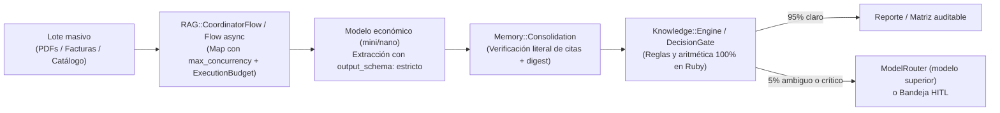

# Escenarios Comerciales de Procesamiento Largo con Modelos Económicos sobre `agentkit-rails`

## Principio Arquitectónico: Por qué los modelos baratos triunfan dentro de `agentkit-rails`

Usar los modelos más económicos de OpenAI (gama `mini` / `nano`) en tareas abiertas de cientos de páginas suele fallar por alucinaciones, JSON roto y pérdida de contexto. Sin embargo, dentro de `agentkit-rails` ese patrón se convierte en una **ventaja económica (márgenes brutos del 85–95%)** al aplicar una regla estricta:

> **El modelo barato solo hace percepción y extracción acotada sobre fragmentos pequeños (Map/Reduce); Ruby determinista ejecuta las validaciones de contrato (`output_schema:`), la verificación literal de citas (`Memory::Consolidation`), la aritmética y las reglas de negocio (`Knowledge::DecisionGate`).**

### Patrón común de ejecución (Tiered Routing + Map/Reduce Durable)

---

## Escenario 1: Auditor Masivo de Licitaciones (RFPs), Pliegos y *Data Rooms* (Recomendación #1)

### 1. Problema y carga de procesamiento largo
Un pliego de licitación (construcción, energía, salud, gobierno, TI) o un *data room* de M&A/auditoría suele contener **300 a 2,000 páginas** repartidas en 20–50 PDFs (bases administrativas, anexos técnicos, penalidades, garantías, cronogramas). Un equipo humano tarda 2 a 4 días en leerlo; omitir un solo requisito obligatorio provoca la descalificación o una multa contractual.

Procesar todo el paquete de forma rigurosa toma **10 a 30 minutos en segundo plano** mediante ActiveJob y barreras SQL de `Flow` async.

### 2. Arquitectura sobre `agentkit-rails`
* **Particionado y paralelismo:** `RAG::CoordinatorFlow` + `ChapterChunker` + `Flow` async (`map` → `join` → `reduce`) con `max_concurrency` acotado y reanudación automática tras caídas sin re-ejecutar fragmentos completados.
* **Extracción tipada con modelo barato:** cada `StepNode` aplica `output_schema:` estricto para extraer `{ requirement_id, category, mandatory, deadline, penalty, source_page, exact_quote }`.
* **Cero requisitos inventados:** `Memory::Consolidation` valida que `exact_quote` sea subcadena literal del PDF versionado.
* **Cruce determinista:** `Knowledge::Engine` evalúa los requisitos extraídos contra el perfil y certificaciones vigentes del cliente (`entailed` = cumple, `not_entailed` = descalificante, `incomplete` = falta documento).
* **Escalación selectiva:** solo las cláusulas ambiguas o de alto riesgo pasan a `ModelRouter` (perfil `:complex`) o a revisión en `HITL`.

### 3. Economía unitaria y potencial comercial
* **Costo estimado por corrida (1,000 páginas en modelo `nano`/`mini`):** **\$0.20 – \$1.50** en tokens.
* **Precio B2B:** **\$299 – \$999/mes** (o **\$99 por licitación**).
* **Ventaja para MVP:** no requiere integraciones complejas con ERPs para arrancar; el flujo inicial es subir PDFs y descargar/revisar la Matriz de Cumplimiento + Checklist de Riesgos.

### 4. MVP en 4 semanas
1. **Semana 1:** App Rails 8 multi-tenant + carga de paquetes PDF + ingesta con `ChapterChunker`.
2. **Semana 2:** `Flow` async Map/Reduce con `output_schema:` + verificación literal de citas.
3. **Semana 3:** Perfil de empresa del cliente + reglas en `Knowledge::Engine` (`cumple` / `no_cumple` / `falta_evidencia`).
4. **Semana 4:** Bandeja `HITL` para validar hallazgos críticos + exportación de matriz a Excel/PDF.

---

## Escenario 2: Auditor Nocturno de Facturas, Fletes y Tarifarios (*Freight & AP Audit*)

### 1. Problema y carga de procesamiento largo
Importadoras, operadores logísticos (3PL), distribuidores B2B y despachos contables reciben **miles de facturas PDF, guías de envío y notas de crédito** cada mes. Cruzar cada concepto contra contratos y tarifarios vigentes para detectar sobrecargos, cargos accesorios indebidos, duplicados o errores fiscales requiere **corridas nocturnas por lotes** de larga duración.

### 2. Arquitectura sobre `agentkit-rails`
* **Orquestación nocturna acotada:** `Routines` + `Flow` async por lotes con `ExecutionBudget` (techo de costo USD/tokens por cliente) y `stall_limit` para evitar bucles improductivos.
* **Extracción barata + aritmética en Ruby:** el modelo `nano`/`mini` **nunca calcula totales ni diferencias**; solo normaliza las líneas del PDF a un JSON validado por `output_schema:`.
* **Dictamen transaccional:** `Knowledge::ActiveRecordSource` + `DecisionGate` cruza cada línea contra las tarifas contractuales y órdenes de compra en PostgreSQL.
* **Gestión de reclamos:** solo las discrepancias confirmadas pasan a `HITL` con la evidencia y citas exactas listas para abrir reclamo al proveedor.
* **Aprendizaje gobernado:** `HITL::Ledger#flag_repeated_rejections!` detecta excepciones tarifarias recurrentes y las registra como `Memory::KnowledgeGaps` para actualización controlada.

### 3. Economía unitaria y potencial comercial
* **Costo estimado (5,000 facturas/mes en modelo `nano`/`mini`):** **< \$5/mes** en tokens.
* **Precio B2B:** **\$500 – \$2,000/mes** (o fee base + porcentaje del dinero recuperado en sobrecargos).
* **Venta:** ROI inmediato demostrable corriendo una auditoría histórica sobre los últimos 90 días de facturas del prospecto.

### 4. MVP en 4 semanas
1. **Semana 1:** Carga de tarifario contractual (CSV/JSON) + bandeja de facturas PDF (correo/upload).
2. **Semana 2:** `Flow` async de extracción tipada (`output_schema:`) con modelo `nano`/`mini`.
3. **Semana 3:** Motor determinista en `Knowledge::DecisionGate` (sobrecargos, duplicados, impuestos).
4. **Semana 4:** Bandeja `HITL` de discrepancias con evidencia + reporte mensual de ahorro recuperado.

---

## Escenario 3: Auditor Masivo de Catálogos y Cumplimiento de Marketplaces / Regulación

### 1. Problema y carga de procesamiento largo
Tiendas de e-commerce de gran volumen, marcas D2C, farmacéuticas y fintechs mantienen **10,000+ fichas de producto, etiquetas, descripciones o anuncios** que deben auditarse periódicamente contra políticas cambiantes (Amazon, MercadoLibre, COFEPRIS/FDA, normativa financiera). Una infracción no detectada provoca suspensiones de cuenta o multas.

### 2. Arquitectura sobre `agentkit-rails`
* **Corridas periódicas en background:** `Routines` + `Flow` async (`map` con `batch_size` y `max_concurrency`) recorre todo el catálogo en segundo plano.
* **Clasificación barata con contrato:** modelo `nano`/`mini` extrae afirmaciones prohibidas, campos faltantes o inconsistencias por ítem bajo `output_schema:`.
* **Reglas versionadas y alertas:** `Knowledge` mantiene las políticas versionadas por marketplace/país; `Operations::Monitor` + `Operations::Escalations` alerta infracciones críticas con SLA y confirmación humana.
* **Optimización continua:** `GovernedStudy` + `AblationEvaluation` permite actualizar el modelo económico y podar instrucciones redundantes sin perder precisión.

### 3. Economía unitaria y potencial comercial
* **Costo estimado (10,000 fichas/mes en modelo `nano`/`mini`):** **\$1 – \$4/mes** en tokens.
* **Precio B2B:** **\$300 – \$1,500/mes** por catálogo monitoreado.

### 4. MVP en 4 semanas
1. **Semana 1:** Importación de catálogo (CSV/Shopify/API) + editor de reglas de cumplimiento.
2. **Semana 2:** `Flow` async por lotes con modelo `nano`/`mini` y `output_schema:` de hallazgos.
3. **Semana 3:** Cola `HITL` con severidad, cita del texto infractor y sugerencia de corrección.
4. **Semana 4:** Corridas programadas (`Routines`) + alertas `Operations::Escalations` + dashboard de cumplimiento.

---

## Matriz Comparativa y Criterio de Decisión

| Criterio | Escenario 1: Licitaciones / *Data Rooms* | Escenario 2: Auditoría de Facturas / Fletes | Escenario 3: Cumplimiento de Catálogos |
| :--- | :--- | :--- | :--- |
| **Fricción de entrada (MVP)** | **Muy baja** (solo subir PDFs) | Media (PDFs + tarifarios) | Baja (CSV / feed de catálogo) |
| **Duración típica por corrida** | 10–30 min (por pliego) | 15–60 min (lote nocturno) | 15–45 min (catálogo completo) |
| **Costo en tokens (modelo `mini`/`nano`)** | \$0.20 – \$1.50 / pliego | < \$5 / 5,000 facturas | \$1 – \$4 / 10,000 ítems |
| **Precio B2B objetivo** | \$299 – \$999/mes | \$500 – \$2,000/mes | \$300 – \$1,500/mes |
| **Claridad del ROI** | Alta (días ahorrados + evitar descalificación) | **Inmediata** (dinero recuperado) | Alta (evitar suspensiones/multas) |

> [!TIP]
> **Por dónde empezar:** elige el **Escenario 1 (Licitaciones / *Data Rooms*)** si buscas lanzar el MVP más rápido sin depender de integraciones con terceros; elige el **Escenario 2 (Facturas y Fletes)** si tienes acceso directo a empresas de logística, importación o distribución para correr una auditoría piloto de 90 días y demostrar ahorro en efectivo desde la semana 1.
