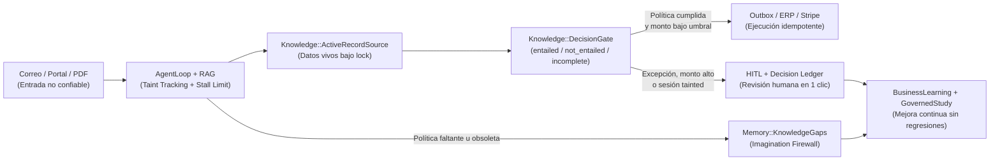
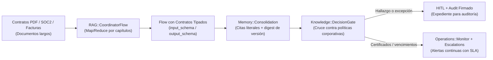

# Recomendación Estratégica de Producto SaaS sobre `agentkit-rails`

## Resumen Ejecutivo

`agentkit-rails` no es un framework más para construir chatbots o agentes creativos. Su ventaja competitiva real reside en ser un **Control Plane gobernable, determinista y nativo de Rails/PostgreSQL** diseñado para **decisiones empresariales de alto impacto financiero o regulatorio**, donde los agentes "caja negra" son inaceptables.

Sus diferenciadores técnicos más difíciles de replicar son:
* **Inferencia verificable y compuertas transaccionales:** `Agentkit::Knowledge`, `ActiveRecordSource` (bajo row-lock), `DecisionGate` y `Journal` con derivaciones auditables (`entailed`, `not_entailed`, `incomplete`).
* **Gobernanza humana real:** `HITL` con *Decision Ledger*, taxonomía cerrada de rechazos y separación estricta entre *proponer* y *autorizar*.
* **Seguridad estructural en runtime:** aislamiento de contenido no confiable con *taint tracking* (`AgentLoop` + `ToolCatalog`), presupuestos durables (`ExecutionBudget`), detección de *stall* y `Audit` firmado.
* **Evolución controlada del conocimiento y del harness:** `Memory::Consolidation` con citas verificables, `Memory::KnowledgeGaps` bajo *Imagination Firewall*, `TeamMemory::SkillExtractor` en cuarentena, `BusinessExperiment` (A/B ITT) y `GovernedStudy` + `AblationEvaluation`.

Este documento recomienda **dos oportunidades SaaS B2B** donde estas capacidades se convierten en una ventaja injusta comercialmente defendible:

1. **Oportunidad 1 (Recomendación principal):** Motor Autónomo de Disputas, Devoluciones y Excepciones de Facturación / Logística B2B.
2. **Oportunidad 2 (Alternativa de alto margen):** Plataforma de Compliance y Auditoría de Proveedores y Contratos (TPRM & Procurement).

---

## Oportunidad 1: Motor Autónomo de Disputas, Devoluciones y Excepciones de Facturación / Logística B2B

### 1. El problema
Empresas de e-commerce de alto volumen, distribución mayorista B2B, operadores logísticos (3PL/fletes) y plataformas de pagos pierden entre el **2% y el 6% de sus ingresos operativos** gestionando manualmente excepciones:
* Disputas de facturas (*short-pays*, deducciones por descuentos, diferencias de precio o cantidad).
* Devoluciones y reembolsos con reglas contractuales complejas (ventanas de tiempo, categoría de producto, pruebas fotográficas, nivel de cliente).
* Contracargos (*chargebacks*) y reclamos de mercancía dañada o entregada fuera de SLA.

Cada caso combina **entradas no confiables** (correos del cliente, PDFs, fotos, notas de soporte) con **reglas de negocio estrictas** (contratos, políticas vigentes, historial del ERP). Los equipos actuales usan hojas de cálculo y revisión manual lenta; los agentes genéricos de IA son demasiado riesgosos porque alucinan aprobaciones y son vulnerables a *prompt injection*.

### 2. Propuesta de valor
> **"Resuelve automáticamente hasta el 70% de tus disputas y devoluciones con 0% de aprobaciones fuera de política y trazabilidad 100% auditable."**

En lugar de vender "IA", el producto vende **protección de margen, velocidad de resolución y cumplimiento demostrable**.

### 3. Arquitectura sobre `agentkit-rails`

#### Mapeo exacto de módulos del framework
| Necesidad del SaaS | Módulo de `agentkit-rails` | Garantía técnica |
| :--- | :--- | :--- |
| Ingesta de correos/PDFs sin riesgo de *prompt injection* | `AgentLoop` (`tainted` / `untrusted_output: true`) + `ToolCatalog` | Si el caso leyó contenido externo no confiable, el `authorize` bloquea herramientas sensibles o fuerza revisión humana. |
| Evaluar si procede un reembolso o crédito | `Knowledge` + `ActiveRecordSource` + `DecisionGate` | Distingue `entailed`, `not_entailed` e `incomplete` (pide evidencia faltante en vez de adivinar) dentro de una transacción ACID. |
| Escalar casos ambiguos o de monto alto | `HITL` + Decision Ledger + `Proposals` | El analista ve las citas exactas y la derivación lógica; aprueba, modifica o rechaza con razón estructurada. |
| Evitar bucles zombis y controlar gasto por caso | `ExecutionBudget` + `stall_limit` | Cada caso tiene un techo estricto de costo USD y corta si el agente deja de progresar. |
| Detectar huecos en políticas de clientes | `Memory::KnowledgeGaps` + `Memory::Consolidation` | Los vacíos de política se registran sin mutar reglas; un humano aprueba la actualización con citas. |
| Demostrar ROI y optimizar políticas | `BusinessLearning` + `BusinessExperiment` + `AblationEvaluation` | Mide tasa de recuperación real y retira instrucciones obsoletas del harness sin regresiones. |

### 4. Perfil de cliente ideal (ICP) y modelo de negocio
* **ICP:** Directores de Operaciones, Finanzas (AR/AP) o Soporte en distribuidores B2B, marcas D2C/e-commerce con >5,000 órdenes/mes, o 3PLs con >500 disputas/mes.
* **Pricing:** Plataforma base **\$1,000 – \$3,500/mes** + tarifa variable por caso resuelto (**\$0.50 – \$2.00/caso**) o % sobre monto recuperado en contracargos.
* **Métrica de venta (ROI):** Reducción de tiempo medio de resolución (de días a minutos), reducción de fugas por reembolsos indebidos y ahorro directo en horas de analistas.

### 5. Alcance de MVP (4–6 semanas)
1. **Semana 1–2:** App Rails 8 multi-tenant + conector de entrada (Shopify/Stripe o correo/webhook) + ontología inicial de devoluciones/disputas en `Agentkit::Knowledge` (partiendo de `examples/knowledge_returns.rb`).
2. **Semana 3–4:** Pipeline `AgentLoop` con `taint tracking`, `DecisionGate` y bandeja HITL en Rails mostrando evidencia, citas y botones de aprobar/rechazar.
3. **Semana 5–6:** `KnowledgeGaps` para capturar excepciones no documentadas + reporte ejecutivo semanal de dinero protegido, tasa de automatización y auditoría exportable.

---

## Oportunidad 2: Plataforma de Compliance y Auditoría de Proveedores y Contratos (TPRM & Procurement)

### 1. El problema
Equipos de Compras (*Procurement*), Legal Ops y Seguridad/Compliance dedican cientos de horas mensuales a tareas repetitivas pero críticas:
* Revisar contratos extensos de proveedores (MSAs, DPAs, SLAs) buscando cláusulas de riesgo, renovaciones automáticas o límites de responsabilidad fuera de política.
* Evaluar cuestionarios de seguridad y cumplimiento (SOC 2, ISO 27001, GDPR, HIPAA) y verificar que las evidencias adjuntas realmente respalden las respuestas.
* Ejecutar conciliaciones (*3-way matching*) entre contrato, orden de compra y factura antes de liberar pagos.

En este dominio, **una respuesta sin cita exacta y sin rastro auditable no sirve de nada**: los auditores internos y externos exigen probar *qué versión del documento* se revisó, *qué regla vigente* se aplicó y *quién aprobó* cada excepción.

### 2. Propuesta de valor
> **"Audita contratos, evidencias de proveedores y facturas en minutos con dictámenes basados en citas literales, contratos de datos estrictos y expediente inmutable listo para auditoría."**

### 3. Arquitectura sobre `agentkit-rails`

#### Mapeo exacto de módulos del framework
| Necesidad del SaaS | Módulo de `agentkit-rails` | Garantía técnica |
| :--- | :--- | :--- |
| Procesar contratos o reportes SOC 2 de 100+ páginas | `RAG::CoordinatorFlow` + `ChapterChunker` | Divide y analiza documentos masivos en paralelo (Map/Reduce) con concurrencia acotada. |
| Evitar que un fallo de extracción corrompa el dictamen | `Flow::Nodes::StepNode` (`input_schema:` / `output_schema:`) | Valida el contrato JSON en cada frontera del grafo; si una extracción es incompleta, falla cerrado en ese nodo. |
| Probar cada hallazgo frente a un auditor | `Memory::Consolidation` + `Journal` + `Audit` firmado | Cada afirmación guarda cita textual exacta, versión/digest del documento y revisor independiente. |
| Vigilar vencimientos (seguros, certificaciones, renovaciones) | `Operations::Monitor` + `Operations::Escalations` | Cola durable con *leases*, reintentos y escalación humana; una fuente no disponible nunca se reporta como "sana". |
| Mantener el *playbook* legal/compliance actualizado | `TeamMemory::Wiki` + `KnowledgeGaps` + `SkillExtractor` | Detecta cláusulas nuevas no cubiertas por el playbook y las propone en cuarentena para aprobación de Legal. |

### 4. Perfil de cliente ideal (ICP) y modelo de negocio
* **ICP:** CISOs, Directores de Compliance, Legal Ops o Procurement en empresas B2B reguladas (fintech, healthtech, SaaS enterprise con >100 empleados o >50 proveedores activos).
* **Pricing:** **\$800 – \$3,000/mes** por organización según número de proveedores activos o documentos auditados al mes.
* **Ventaja comercial:** Alta retención (*churn* muy bajo) porque el expediente auditable se vuelve parte del proceso anual de certificación (SOC 2 / ISO / auditoría financiera).

### 5. Alcance de MVP (4–6 semanas)
1. **Semana 1–2:** Carga de documentos PDF/DOCX multi-tenant + ingesta con `RAG::CoordinatorFlow` y `ChapterChunker`.
2. **Semana 3–4:** `Flow` tipado de 3 etapas (`extract_clauses` → `evaluate_policy` → `compile_dossier`) con `input_schema`/`output_schema` y citas verificadas en `Memory::Consolidation`.
3. **Semana 5–6:** Vista de expediente auditable con `HITL` para aprobar/rechazar excepciones de cláusulas + `Operations::Escalations` para alertas de vencimiento de certificados.

---

## Matriz Comparativa y Recomendación de Ejecución

| Criterio | Oportunidad 1: Disputas y Excepciones B2B | Oportunidad 2: Compliance y Auditoría de Proveedores |
| :--- | :--- | :--- |
| **Velocidad de venta (ciclo comercial)** | **Rápida** (dolor diario, ROI directo en efectivo) | Media (ciclos de compra de Legal/Compliance) |
| **Claridad del ROI** | **Inmediata** (\$ recuperados + horas ahorradas en semana 1) | Alta pero más cualitativa (riesgo evitado + horas de auditoría) |
| **Profundidad de uso de `agentkit-rails`** | Máxima (`Knowledge`, `DecisionGate`, `Taint`, `HITL`, `BusinessExperiment`) | Máxima (`CoordinatorFlow`, `Flow` tipado, `Consolidation`, `Audit`, `Operations`) |
| **Retención (*stickiness*)** | Alta (integrado al flujo operativo diario) | **Muy alta** (sistema de registro para auditorías) |
| **Complejidad de integraciones iniciales** | Media (Shopify/Stripe/ERP/Email) | **Baja** (arranca con carga de PDFs + correo) |

### Recomendación final

> [!IMPORTANT]
> **Empieza por la Oportunidad 1** si buscas **tracción comercial rápida y ROI medible en días** (ideal para validar con clientes piloto en e-commerce B2B, logística o fintech).
>
> **Empieza por la Oportunidad 2** si tienes **acceso directo a compradores de Legal/Compliance/Procurement** y prefieres un MVP con **menos integraciones externas** (basado principalmente en documentos PDF y playbooks).

En ambos casos, el diferenciador que debes poner en la portada del producto no es *"agentes autónomos"*, sino **"automatización con evidencia verificable, compuertas de decisión y control humano auditable"** — exactamente la tesis arquitectónica que ya construiste en `agentkit-rails`.
